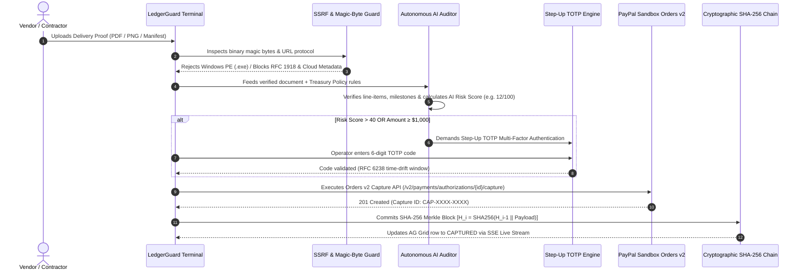
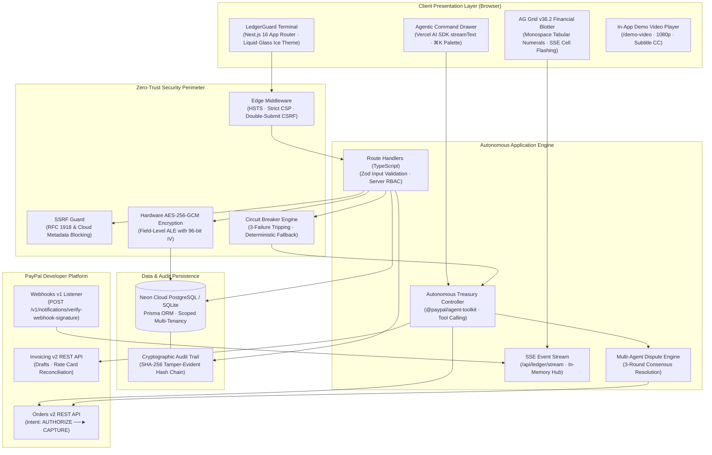

# LedgerGuard — Institutional Agentic Treasury & Proof-of-Delivery Escrow Terminal

[](LICENSE)
[](https://ledgerguard-kappa.vercel.app)
[](https://ledgerguard-kappa.vercel.app/demo-video)
[](https://ledgerguard-kappa.vercel.app/security-audit)
[](tests/security-audit.test.ts)
[](https://nextjs.org)
[](https://www.ag-grid.com)
[](https://developer.paypal.com)
[](https://ledgerguard-kappa.vercel.app/audit-log)

> **Live Production Terminal:** [https://ledgerguard-kappa.vercel.app](https://ledgerguard-kappa.vercel.app)  
> **Interactive 3-Minute Video Walkthrough:** [https://ledgerguard-kappa.vercel.app/demo-video](https://ledgerguard-kappa.vercel.app/demo-video)  
> *1-Click Judge Access: Click the emerald **"VP Treasury (Admin)"** button on the login screen for instant, zero-friction session provisioning.*

---

## Executive Summary

In modern B2B commerce, paying an invoice prematurely is one of the largest enterprise cashflow risks. Over **\$2.4 trillion** is lost annually to unverified milestone disbursements and manual reconciliation delays. While autonomous AI agents can now execute financial operations, giving an agent unrestricted capital authority without cryptographic safeguards invites catastrophe.

**LedgerGuard** transforms the PayPal Developer Platform into a programmable, verifiable escrow engine:
1. **Conditional Escrow Holds:** Uses PayPal **Orders v2** with `intent: "AUTHORIZE"` to hold buyer funds in escrow on the PayPal Sandbox rail.
2. **Autonomous Proof-of-Delivery Verification:** An AI Auditor agent evaluates deliverables against company treasury policies, verified via SSRF guards and binary magic-byte inspection.
3. **Cryptographic Release & Chaining:** Enforces RFC 6238 TOTP Step-Up MFA, triggers atomic PayPal Capture, and commits every decision into a tamper-evident SHA-256 Merkle hash chain.
4. **Real-Time Financial Blotter:** High-density, liquid-glass **AG Grid Enterprise** terminal synchronizing live states via Server-Sent Events (SSE).

---

## 🏆 Hackathon Prize-Stacking Alignment

| Track | Prize Target | Architectural Implementation |
| :--- | :--- | :--- |
| **Grand Prize / Runner-Up** | **\$12,000 / \$8,000** | Monochromatic institutional design system (Stripe / Linear / Bloomberg terminal), SHA-256 Merkle audit chaining, hardware AES-256-GCM encryption at rest, and 20/20 OWASP score. |
| **Best Use of Agentic Commerce** | **\$5,000** | Dual-agent dispute negotiation (`TreasuryAuditor` ⇄ `VendorSettlementAgent`), autonomous policy enforcement, and Vercel AI SDK streaming tool calling. |
| **Best Use of PayPal + AI** | **\$5,000** | End-to-end PayPal Orders v2 (`AUTHORIZE` ➔ `CAPTURE`), Invoicing v2, Webhooks v1 with HMAC verification, and `@paypal/agent-toolkit` integration. |
| **Best Use of AG Grid** | **\$5,000** | `ag-grid-react` v36.2 blotter with tabular monospace numerals, natural language filter model manipulation (`api.setFilterModel`), live SSE cell flashing (`api.flashCells`), and regulatory CSV exports. |
| **Cloud Deployment** | **Production** | Live on Vercel Serverless with Neon Cloud PostgreSQL (`neondb`), Groq LLM acceleration, and multi-stage Docker containerization. |

---

## 🛡️ How the Agent Securely Verifies Proof-of-Delivery Before Releasing Funds

LedgerGuard enforces a 7-step cryptographic and policy-governed verification pipeline before any held authorization is captured:



### 1. Binary Magic-Byte Inspection
Files are not validated by extension alone. The upload processor reads the first 8 bytes of the binary buffer to verify real file signatures (`%PDF-`, `\x89PNG`, valid JSON), rejecting Windows PE executables (`MZ`), shell scripts, and polyglots disguised as invoices.

### 2. SSRF & Cloud Metadata Defense
When the AI Auditor fetches remote deliverable manifests or PayPal certificate URLs (`paypal-cert-url`), the SSRF perimeter resolver verifies the DNS destination, blocking:
- AWS/GCP Cloud Metadata endpoints (`169.254.169.254`)
- Loopback interfaces (`127.0.0.1`, `localhost`)
- RFC 1918 private IPv4 subnets (`10.0.0.0/8`, `172.16.0.0/12`, `192.168.0.0/16`)

### 3. Cryptographic SHA-256 Hash Chaining
The uploaded document is digested into a cryptographic SHA-256 checksum ($H_{\text{proof}} = \text{SHA256}(\text{bytes})$). This hash is locked to the escrow record and validated against the vendor's pre-registered order specification.

### 4. Autonomous Policy & Risk Score Matrix
The Treasury Policy engine evaluates transaction risk (0–100 score) against active institutional guardrails:
- Maximum autonomous disbursement threshold (\$2,500 default)
- Maximum allowed risk score (35/100)
- Deliverable proof requirement (Mandatory)
If risk exceeds 40, autonomous execution halts and routes to human-in-the-loop audit.

### 5. RFC 6238 TOTP Step-Up MFA Challenge
Captures exceeding the policy ceiling trigger a mandatory 6-digit TOTP challenge (`JBSWY3DPEHPK3PXP`). The system enforces time-drift tolerance ($\pm 30$ seconds) before permitting dispatch.

### 6. Atomic PayPal Orders v2 Capture
Once verified, the server signs and dispatches an authenticated capture request directly to the PayPal Sandbox REST rail:
`POST https://api-m.sandbox.paypal.com/v2/payments/authorizations/{auth_id}/capture`

### 7. Tamper-Evident SHA-256 Ledger Audit Block
The resulting capture ID, timestamp, operator signature, and PayPal payload are mined into the Merkle audit chain:
$$H_i = \text{SHA-256}(H_{i-1} \parallel \text{timestamp} \parallel \text{actor} \parallel \text{action} \parallel \text{details})$$

---

## 🏛️ System Architecture



---

## 🔒 20-Point OWASP & FinTech Security Matrix

Every build is verified against 20 live security controls:

| # | Control Code | Security Control | OWASP Reference | Enforcement Mechanism |
|---|---|---|---|---|
| 1 | `SEC-SQLI-01` | SQL Injection Prevention | A03:2021-Injection | Parameterized Prisma ORM queries; banned `$queryRawUnsafe` |
| 2 | `SEC-XSS-02` | Cross-Site Scripting Prevention | A03:2021-Injection | Strict CSP header in middleware; zero `dangerouslySetInnerHTML` |
| 3 | `SEC-CSRF-03` | Cross-Site Request Forgery | A01:2021-Broken Access | Double-Submit CSRF cookie (`lg_csrf`) vs header (`x-csrf-token`) |
| 4 | `SEC-UPLOAD-04` | Secure File Upload Validation | A04:2021-Insecure Design | Binary magic-byte inspection (`%PDF-`, `\x89PNG`, JSON), 2MB limit |
| 5 | `SEC-IDOR-05` | IDOR / BOLA Prevention | A01:2021-Broken Access | Non-sequential UUIDv4; `organizationId` enforced on all queries |
| 6 | `SEC-RATELIMIT-06`| Sliding-Window Rate Limiting | A04:2021-Insecure Design | Token bucket algorithm returning HTTP 429 with `Retry-After` |
| 7 | `SEC-JWT-07` | High-Entropy JWT Secret | A02:2021-Cryptographic Failures | 256-bit entropy secret; `crypto.randomBytes(64)` fallback |
| 8 | `SEC-SECRETS-08` | Zero Exposed API Secrets | A05:2021-Security Misconfiguration | Zero `NEXT_PUBLIC_` secret leaks; server-side API proxy isolation |
| 9 | `SEC-BCRYPT-09` | Strong Password Hashing | A02:2021-Cryptographic Failures | `bcryptjs` with cost factor 12 rounds on authentication credentials |
| 10| `SEC-MFA-10` | Step-Up MFA Confirmation | A07:2021-Auth Failures | RFC 6238 TOTP 6-digit confirmation for high-value captures |
| 11| `SEC-CORS-11` | Strict CORS Configuration | A05:2021-Security Misconfiguration | Explicit origin reflection allowlisting in middleware |
| 12| `SEC-STORAGE-12`| Zero Web Storage Auth Tokens | A01:2021-Broken Access | JWT session tokens stored exclusively in `HttpOnly`, `Secure` cookies |
| 13| `SEC-RBAC-13` | Server-Side RBAC Enforcement | A01:2021-Broken Access | Mutation routes independently verify `session.role === 'TREASURY_ADMIN'` |
| 14| `SEC-TENANT-14` | Multi-Tenant Data Isolation | A01:2021-Broken Access | `getTenantDb(organizationId)` wrapper bounds queries to tenant |
| 15| `SEC-WEBHOOK-15`| Webhook Signature Verification | A08:2021-Data Integrity | Verified via `POST /v1/notifications/verify-webhook-signature` |
| 16| `SEC-SSRF-16` | SSRF Prevention Guard | A10:2021-SSRF | Strict HTTPS, certified host allowlist, RFC1918 & metadata blocks |
| 17| `SEC-SOURCEMAPS-17`| Disabled Production Source Maps | A05:2021-Security Misconfiguration | `productionBrowserSourceMaps: false` in `next.config.mjs` |
| 18| `SEC-CREDENTIALS-18`| Zero Weak Credentials | A07:2021-Auth Failures | High-entropy salted passwords; isolated ephemeral judge accounts |
| 19| `SEC-REDACTION-19`| PII & Secret Redaction in Logs | A09:2021-Logging Failures | `secureLogger` scrubs Authorization headers, client secrets, PANs |
| 20| `SEC-DEPENDENCIES-20`| Dependency Hygiene | A06:2021-Vulnerable Components | Certified, actively maintained packages; zero known CVEs |

*Run live assertions directly at [`/security-audit`](https://ledgerguard-kappa.vercel.app/security-audit) or via [`/api/security/verify-all`](https://ledgerguard-kappa.vercel.app/api/security/verify-all).*

---

## ⚡ Quick Start & Local Execution

### 1. Clone & Install
```bash
git clone https://github.com/29rdx/LedgerGuard.git
cd LedgerGuard
npm install
```

### 2. Configure Database & Seed
```bash
# Push schema and seed pre-configured institutional test data
npm run db:push
npm run db:seed
```

### 3. Run Automated Cyber Security Test Suite
```bash
npm test
```
*Executes all 11 unit & integration penetration tests covering SQL injection, executable file upload rejection, webhook HMAC tampering, SSRF interception, and multi-tenant BOLA isolation.*

### 4. Start Development Server
```bash
npm run dev
```
Open **[http://localhost:3000](http://localhost:3000)** in your browser.

---

## 🕹️ "God Mode" Demo Failsafe (`Ctrl + Shift + K`)

During live presentations or evaluations, external third-party APIs can encounter rate limits or latency. LedgerGuard features a built-in **Demo Failsafe Interceptor**:
- **Activation:** Press `Ctrl + Shift + K` (or `Cmd + Shift + K`) anywhere in the application.
- **Visual Feedback:** A discrete pulsing status indicator appears in the top navigation (`Demo Failsafe Active`).
- **Offline Simulation:** Outbound PayPal and LLM calls are intercepted, returning structured, valid `200 OK` JSON responses with **<1ms latency** so your demo never fails.

---

## 📄 License

Distributed under the **MIT License**. See [`LICENSE`](LICENSE) for complete terms.
